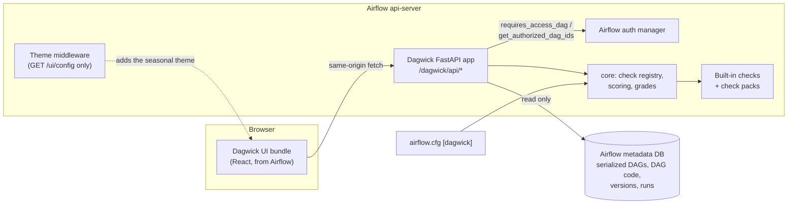

# Architecture

Dagwick is an Apache Airflow 3 plugin. It has no server, database or process of
its own: it runs inside Airflow's api-server and reads what Airflow already
stores. It also ships an optional `dagwick check` command for CI.

## Parts

| Part | Where | What it does |
| --- | --- | --- |
| Plugin registration | `src/dagwick/plugin.py` | An `AirflowPlugin` that mounts the FastAPI app at `/dagwick`, adds the theme middleware, and registers two React apps: a **Dagwick tab** on every DAG and a **fleet page** in the sidebar. |
| HTTP API | `src/dagwick/api.py` | `score`, `history`, `health` and `fleet` endpoints, plus `config`, `checks` and `themes`. Every data endpoint is guarded by Airflow's own security dependencies. Static files come from a fixed allowlist. |
| Scoring engine | `src/dagwick/core.py` | The `@check` decorator and registry, running each check on a serialized DAG, acknowledgements, points and grades. |
| Checks | `src/dagwick/checks/` | One module per category: reliability, observability, ownership, scheduling, structure, performance, security. Check packs add more through the `dagwick.checks` entry point. |
| Acknowledgements | `src/dagwick/acknowledge.py` | Reads `# dagwick: ack` comments from DAG source with `tokenize`, never by executing it. |
| History and health | `src/dagwick/history.py`, `health.py` | Score past DAG versions, and summarise recent runs and task retries, with read-only SQLAlchemy queries. |
| Settings | `src/dagwick/settings.py` | Optional, non-secret `[dagwick]` settings: `seasonal_moods`, `disabled_checks`, `weights`, `grades`. |
| Themes | `src/dagwick/themes.py`, `snow.py`, `halloween.py` | Seasonal themes for the whole Airflow UI, added to Airflow's `/ui/config` reply by a middleware. |
| UI | `ui/src/` → `src/dagwick/static/dagwick.js` | React and TypeScript, built with Vite into one bundle that uses the React Airflow already provides. |
| CLI | `src/dagwick/cli.py` | `dagwick check <paths>`: loads DAG files with Airflow's `DagBag`, serializes them, and scores them with the same engine. |

## How a DAG is scored

1. The browser asks `GET /dagwick/api/score?dag_id=…`.
2. Airflow's security dependencies check that the user may read this DAG (and
   its code and task instances). If not, Airflow refuses the request.
3. Dagwick loads the **serialized** DAG from the metadata database, the DAG's
   source text (for source-based checks such as secrets and acknowledgements)
   and parse statistics.
4. `core.score_dag` runs every enabled check. Each returns a `Finding`
   (pass, warn, fail or skip). Acknowledged checks are excluded from the score.
5. Points are added up and turned into a grade with the configured thresholds.
6. The JSON report goes back to the UI, which renders it.

The fleet page does the same for every DAG the user may read, using
`get_authorized_dag_ids` to narrow the list first.

## The CLI path is different

`dagwick check` runs outside Airflow, on a developer's machine or in CI. It
**imports the DAG files** with `DagBag`, so their top-level code runs, exactly
as Airflow's own DAG processor would. Run it only on DAG files you trust. After
loading, it uses the same serialization and scoring as the plugin.

## Design rules

- No runtime dependencies: Dagwick uses the Airflow and FastAPI already
  installed.
- Read-only: no writes to the database, no DAG execution inside Airflow, no
  network calls.
- Every endpoint reuses Airflow's security; none is unauthenticated except the
  allowlisted static files the UI needs.
- Errors return a generic message and a reference id; details go to the log.

See [assurance-case.md](assurance-case.md) for why these rules make Dagwick
safe to install, and [SECURITY.md](../SECURITY.md) for how to report a problem.
